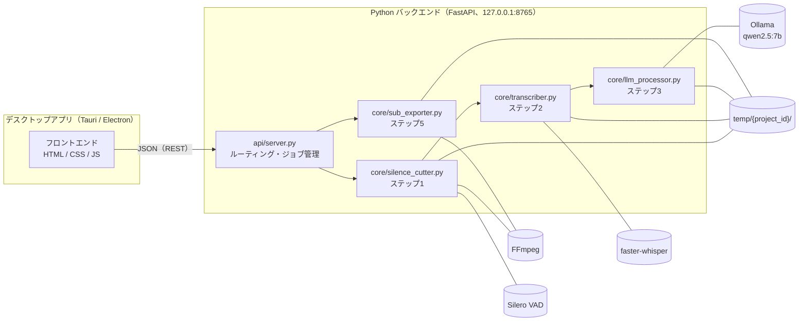
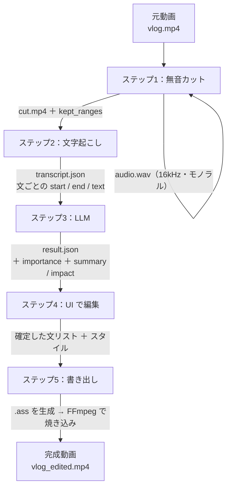

# 00. 全体設計・データの流れ

## 1. 構成

アプリは「画面（フロントエンド）」と「処理エンジン（バックエンド）」の2つに分かれ、同じ PC の中で HTTP で通信する。インターネットには接続せず、AI もすべてローカルで動かす。

| 部分 | 役割 |
|---|---|
| フロントエンド | 動画の選択、進捗の表示、テロップの選択・絞り込み・装飾（ステップ4）、書き出しの指示 |
| `api/server.py` | API の受け口。重い処理はバックグラウンドのジョブとして実行し、進捗を管理する |
| `core/` | 各ステップの処理本体。API からは独立させ、単体でも動かせるようにする |
| `temp/` | 処理途中のファイル置き場（プロジェクトごとにフォルダを分ける） |

## 2. データの流れ

| ステップ | 入力 | 出力 | 担当ファイル | 仕様書 |
|---|---|---|---|---|
| 1. 無音カット | 元動画 | `cut.mp4`、残した区間の対応表（`kept_ranges`） | `core/silence_cutter.py` | `02_silence_cut.md` |
| 2. 文字起こし | `cut.mp4` の音声 | `transcript.json` | `core/transcriber.py` | `03_transcription.md` |
| 3. LLM 処理 | `transcript.json` | `result.json` | `core/llm_processor.py` | `04_llm_processing.md` |
| 4. UI 編集 | `result.json`（API 経由） | 確定した文リスト・スタイル | `frontend/` | `05_ui_design.md` |
| 5. 書き出し | `cut.mp4` ＋ 確定データ | `.ass`、完成動画 | `core/sub_exporter.py` | `06_export_video.md` |

- 文字起こしは **無音カット後の動画** に対して行う。そのため、テロップの時刻はカット後の動画にそのまま合う。
- 元動画の時刻が必要なときは `kept_ranges` で変換する。

## 3. 処理の進め方（API の呼び出し順）

1. `POST /projects` で動画を登録すると、ステップ1〜3がバックグラウンドで順に動く。
2. フロントは `GET /projects/{id}/status` を1秒ごとに呼び、進捗を表示する。
3. 完了したら `GET /projects/{id}/result` で文リストを受け取り、画面に表示する。
4. ユーザーの編集が済んだら `POST /projects/{id}/exports` で書き出しを始め、完了までポーリングする。

リクエストとレスポンスの形は `01_api_schema.md` を参照。

## 4. 設計の方針

- **重い処理は同時に1件ずつ**：Whisper・LLM・FFmpeg は GPU や CPU を大きく使うため、解析と書き出しはそれぞれ1件ずつ実行し、残りは順番待ちにする。
- **途中で失敗しても止めない**：LLM が失敗した文は、重要度 2、要約とインパクト重視は原文と同じ文言で埋め、ユーザーが作業を続けられるようにする。
- **中間ファイルを残す**：各ステップの結果を `temp/{project_id}/` に保存し、失敗したステップだけをやり直せるようにする。
- **重要度の絞り込みはフロントだけで行う**：スライダーを動かすたびに API を呼ばず、すぐ画面に反映させる。
