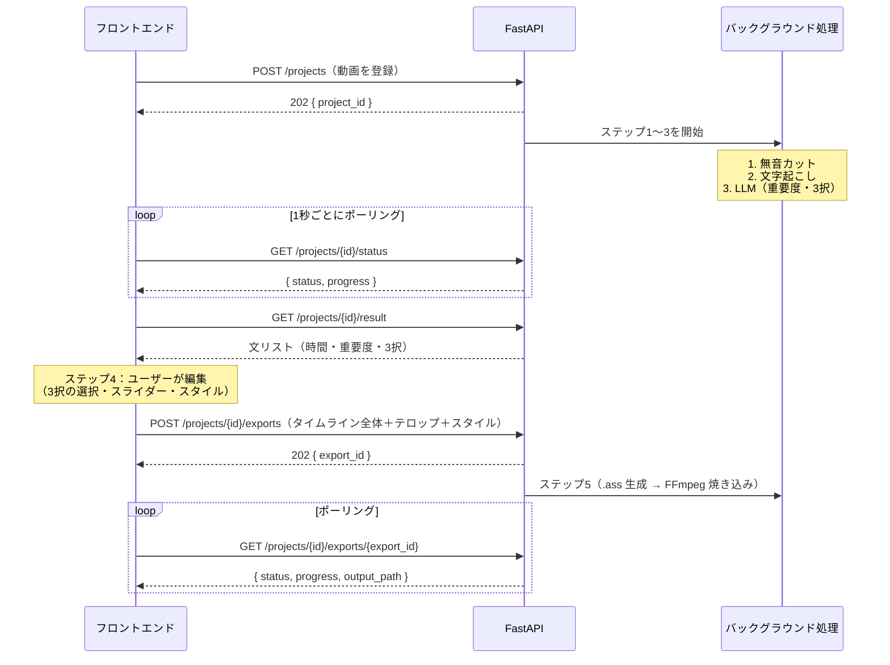

# 01. API仕様書（フロントエンド ⇔ バックエンド）

フロントエンド（Tauri / Electron 上の HTML/CSS/JS）と、ローカルで動作する Python バックエンド（FastAPI）間の通信仕様を定義する。

---

## 1. 概要

### 1.1 全体の処理フロー



### 1.2 エンドポイント一覧

| メソッド | パス | 用途 | ステップ |
|---|---|---|---|
| GET | `/health` | サーバー・依存ツールの起動確認 | - |
| POST | `/projects` | 動画の登録と解析開始 | 1〜3 |
| GET | `/projects/{project_id}/status` | 解析の進捗確認（ポーリング） | 1〜3 |
| POST | `/projects/{project_id}/cancel` | 解析の中断 | 1〜3 |
| GET | `/projects/{project_id}/result` | 解析結果（文リスト）の取得 | 4 |
| GET | `/projects/{project_id}/media/preview` | 無音カット済み動画の取得（プレビュー再生用） | 4 |
| POST | `/projects/{project_id}/exports` | 最終動画の書き出し開始 | 5 |
| GET | `/projects/{project_id}/exports/{export_id}` | 書き出しの進捗確認（ポーリング） | 5 |
| GET | `/projects/{project_id}/exports/{export_id}/download` | 書き出した動画の取得 | 5 |
| GET | `/style-presets` | スタイルプリセットの一覧取得 | 4 |
| POST | `/style-presets` | スタイルプリセットの新規保存 | 4 |
| PUT | `/style-presets/{preset_id}` | スタイルプリセットの上書き更新 | 4 |
| DELETE | `/style-presets/{preset_id}` | スタイルプリセットの削除 | 4 |

---

## 2. 共通仕様

| 項目 | 内容 |
|---|---|
| ベースURL | `http://127.0.0.1:8765/api/v1` |
| 公開範囲 | `127.0.0.1` のみで待ち受ける（外部ネットワークに公開しない） |
| データ形式 | リクエスト・レスポンスともに `application/json; charset=utf-8`（動画のアップロードとダウンロードは除く） |
| 文字コード | UTF-8 |
| 時間の単位 | **秒（float、小数点以下3桁）**。例：`12.345` |
| 時間の基準 | 解析結果の時間は、すべて **無音カット後の動画** のタイムライン上の値 |
| ID の形式 | UUID v4 の文字列 |
| 日時の形式 | ISO 8601（例：`2026-09-29T15:30:00+09:00`） |
| 色の形式 | `#RRGGBB`（不透明度は別フィールドで `0.0`〜`1.0` を指定） |
| CORS | `tauri://localhost`、`http(s)://tauri.localhost`（Windows 版 Tauri v2）、`http://localhost:<任意のポート>`、`http://127.0.0.1:<任意のポート>`、`null`（`file://` で開いたページはオリジンが `null` になる）を許可 |

### 2.1 エラーレスポンス

エラー時は HTTP ステータスコードと合わせて、以下の形式で返す。

```json
{
  "error": {
    "code": "PROJECT_NOT_FOUND",
    "message": "指定されたプロジェクトが見つかりません。",
    "details": { "project_id": "..." }
  }
}
```

| HTTP | code | 発生条件 |
|---|---|---|
| 400 | `INVALID_REQUEST` | リクエストの形式やパラメータが不正 |
| 400 | `UNSUPPORTED_FORMAT` | 対応していない動画形式 |
| 404 | `FILE_NOT_FOUND` | 指定したローカルファイルが存在しない |
| 404 | `PROJECT_NOT_FOUND` | 存在しないプロジェクト ID |
| 404 | `EXPORT_NOT_FOUND` | 存在しない書き出し ID |
| 404 | `PRESET_NOT_FOUND` | 存在しないプリセット ID |
| 409 | `NOT_READY` | 解析が終わる前に結果を取得・書き出ししようとした |
| 409 | `ALREADY_RUNNING` | 同じプロジェクトで処理がすでに実行中 |
| 409 | `PRESET_NAME_CONFLICT` | 同じ名前のプリセットがすでに存在する |
| 409 | `OUTPUT_EXISTS` | 書き出し先に同じ名前のファイルがあり、`output.overwrite` が `false` |
| 422 | `VALIDATION_ERROR` | 値が範囲外など（FastAPI のバリデーションエラー） |
| 500 | `FFMPEG_ERROR` | FFmpeg の実行に失敗 |
| 500 | `TRANSCRIPTION_ERROR` | faster-whisper の処理に失敗 |
| 503 | `LLM_UNAVAILABLE` | Ollama に接続できない、またはモデルが未取得（解析中はこのエラーで止めず、既定値で続けて `result.llm.status` に記録する） |
| 500 | `INTERNAL_ERROR` | その他の想定外のエラー |

---

## 3. データモデル

### 3.1 `Segment`（テロップ1文）

ステップ2（文字起こし）とステップ3（LLM）の結果を1つにまとめたもの。

```json
{
  "id": "seg_0001",
  "index": 0,
  "start": 0.000,
  "end": 2.480,
  "importance": 3,
  "variants": {
    "original": "えーと今日はですね新しいカメラを紹介していきたいと思います",
    "summary": "今日は新しいカメラを紹介します",
    "impact": "新カメラ、ついに解禁！"
  },
  "confidence": 0.92
}
```

| フィールド | 型 | 説明 |
|---|---|---|
| `id` | string | 文の ID（プロジェクト内で一意、書き出し時にもこの ID で指定する） |
| `index` | int | 表示順（0 始まり） |
| `start` / `end` | float | 表示の開始・終了時刻（秒、無音カット後の動画基準） |
| `importance` | int | AI が判定した重要度。`1`=低、`2`=中、`3`=高 |
| `variants.original` | string | 原文（faster-whisper の文字起こし結果そのまま） |
| `variants.summary` | string | 要約版（LLM が生成） |
| `variants.impact` | string | インパクト重視版（LLM が生成） |
| `confidence` | float | 文字起こしの信頼度（`0.0`〜`1.0`）。Whisper の `avg_logprob` から `exp(avg_logprob)` で計算する。UI で「要確認」を表示する目安に使う |

> LLM の処理に失敗した文は `importance: 2`、`summary` と `impact` には `original` と同じ文を入れて返す（UI 側が止まらないようにするため）。

### 3.2 `SubtitleStyle`（テロップのスタイル）

バックエンドはこの値を ASS 字幕の `[V4+ Styles]` に変換する。ASS の `PlayResX` / `PlayResY` は **無音カット後の動画の幅・高さ** にそろえるので、`font_size`・`outline_width`・`margin_v` などの px は、動画の実際のピクセル数が基準になる（フロントのプレビューは、この値をプレビューの大きさに合わせて縮小して表示する）。

```json
{
  "font_family": "Noto Sans JP",
  "font_size": 64,
  "bold": true,
  "italic": false,
  "primary_color": "#FFFFFF",
  "primary_opacity": 1.0,
  "outline_color": "#000000",
  "outline_opacity": 1.0,
  "outline_width": 4.0,
  "shadow_color": "#000000",
  "shadow_opacity": 0.5,
  "shadow_depth": 2.0,
  "background_enabled": false,
  "background_color": "#000000",
  "background_opacity": 0.6,
  "alignment": 2,
  "margin_v": 60,
  "margin_h": 40,
  "letter_spacing": 0.0
}
```

| フィールド | 型 | 範囲・既定値 | ASS での対応 |
|---|---|---|---|
| `font_family` | string | 既定 `"Noto Sans JP"` | `Fontname` |
| `font_size` | int | 8〜300、既定 `64` | `Fontsize` |
| `bold` / `italic` | bool | 既定 `true` / `false` | `Bold` / `Italic`（`-1` or `0`） |
| `primary_color` / `primary_opacity` | string / float | 文字の色 | `PrimaryColour` |
| `outline_color` / `outline_opacity` | string / float | 縁取りの色 | `OutlineColour` |
| `outline_width` | float | 0〜20、既定 `4.0` | `Outline` |
| `shadow_color` / `shadow_opacity` | string / float | 影の色 | `BackColour` |
| `shadow_depth` | float | 0〜20、既定 `2.0` | `Shadow` |
| `background_enabled` | bool | 既定 `false` | `true` のとき `BorderStyle=3`（背景を箱で塗る） |
| `background_color` / `background_opacity` | string / float | 背景の箱の色 | `BorderStyle=3` のときの `OutlineColour`/`BackColour` |
| `alignment` | int | 1〜9（テンキー配置）、既定 `2`（下中央） | `Alignment` |
| `margin_v` / `margin_h` | int | 0〜1000（px） | `MarginV` / `MarginL`・`MarginR` |
| `letter_spacing` | float | -10〜50、既定 `0.0` | `Spacing` |

> **色の変換ルール**：ASS の色は `&HAABBGGRR`（アルファ値は `00`=不透明、`FF`=透明）。
> 例：`#FF8800` と不透明度 `1.0` → `&H000088FF`。変換はバックエンド側で行い、フロントは `#RRGGBB` だけを扱う。

### 3.3 `StylePreset`（保存したスタイル）

```json
{
  "id": "0b8c6c1e-7f0a-4b1e-9a55-1f1a3c2d9e10",
  "name": "ゲーム実況用（黄色・太縁）",
  "style": { "...": "SubtitleStyle" },
  "created_at": "2026-09-29T15:30:00+09:00",
  "updated_at": "2026-09-29T15:30:00+09:00"
}
```

プリセットはバックエンドのユーザーデータフォルダ内の `presets.json` に保存する（アプリを再起動しても残る）。

- ユーザーデータフォルダ：環境変数 `EDITAI_DATA_DIR`、指定がなければ Windows では `%APPDATA%\EditAI`
- `presets.json` がまだないとき（初回起動時）は、UI モックと同じ3つのプリセット（標準・ゲーム実況・ニュース風）を作る。これらも普通のプリセットと同じように変更・削除できる。

---

## 4. エンドポイント詳細

### 4.1 `GET /health` — 起動確認

アプリ起動時に、フロントがバックエンドの起動完了を待つために使う。FFmpeg や Ollama が使えるかもここで確認できる。

**レスポンス `200 OK`**

```json
{
  "status": "ok",
  "version": "0.1.0",
  "dependencies": {
    "ffmpeg": { "available": true, "version": "7.0" },
    "ollama": { "available": true, "models": ["qwen2.5:7b"] },
    "whisper": { "available": true, "device": "cuda" }
  }
}
```

---

### 4.2 `POST /projects` — 動画の登録と解析開始

動画を登録し、バックグラウンドでステップ1〜3（無音カット → 文字起こし → LLM）を開始する。すぐに `202` を返し、完了はポーリングで確認する。

デスクトップアプリでは大きな動画をコピーせずに済むよう、**ローカルのファイルパスを渡す方式（A）を推奨**する。ブラウザだけで動作確認するとき用に、ファイルを直接送る方式（B）にも対応する。

#### 方式A：ローカルパスを指定（`application/json`）

```json
{
  "source_path": "C:/Users/me/Videos/vlog_0929.mp4",
  "options": {
    "silence": {
      "enabled": true,
      "vad_threshold": 0.5,
      "min_silence_ms": 500,
      "padding_ms": 150
    },
    "transcription": {
      "model": "large-v3",
      "language": "ja"
    },
    "llm": {
      "enabled": true,
      "model": "qwen2.5:7b"
    }
  }
}
```

#### 方式B：ファイルを直接送信（`multipart/form-data`）

| フィールド | 型 | 必須 | 説明 |
|---|---|---|---|
| `file` | binary | ○ | 動画ファイル |
| `options` | string | - | 上の `options` を JSON 文字列にしたもの |

#### `options` の詳細（すべて省略可能）

| キー | 型 | 既定値 | 説明 |
|---|---|---|---|
| `silence.enabled` | bool | `true` | `false` にすると無音検出を行わない。文字起こしを続けるときは、元動画をそのまま `cut.mp4` にし、動画全体を残す区間として記録する |
| `silence.vad_threshold` | float | `0.5` | Silero VAD の発話判定のしきい値（0.0〜1.0、高いほど厳しい） |
| `silence.min_silence_ms` | int | `500` | この長さ以上の無音だけをカットする |
| `silence.padding_ms` | int | `150` | 発話区間の前後に残す余白（言葉の頭切れを防ぐ） |
| `transcription.enabled` | bool | `true` | `false` にすると文字起こしと、それに続く LLM 処理を行わない。無音区間だけを返す |
| `transcription.model` | string | `"large-v3"` | faster-whisper のモデル名（`small`、`medium`、`large-v3` など） |
| `transcription.language` | string | `"ja"` | 言語コード |
| `llm.enabled` | bool | `true` | `false` にすると重要度は全文 `2`、3択はすべて原文になる |
| `llm.model` | string | `"qwen2.5:7b"` | Ollama のモデル名 |

対応形式：`.mp4`、`.mov`、`.mkv`、`.avi`、`.webm`

**レスポンス `202 Accepted`**

```json
{
  "project_id": "5f2a9d3e-1c4b-4e8a-b6d7-2a9f0c1e3b4d",
  "status": "queued",
  "created_at": "2026-09-29T15:30:00+09:00"
}
```

**エラー**：`400 UNSUPPORTED_FORMAT`、`404 FILE_NOT_FOUND`、`422 VALIDATION_ERROR`

---

### 4.3 `GET /projects/{project_id}/status` — 解析の進捗確認

フロントは **1秒ごと** にポーリングし、`status` が `completed`・`failed`・`cancelled` のどれかになったら止める。

**レスポンス `200 OK`**

```json
{
  "project_id": "5f2a9d3e-1c4b-4e8a-b6d7-2a9f0c1e3b4d",
  "status": "transcribing",
  "progress": 52.5,
  "current_step": {
    "name": "transcribing",
    "label": "文字起こし中",
    "progress": 40.0
  },
  "steps": [
    { "name": "silence_cutting", "status": "completed", "progress": 100.0 },
    { "name": "transcribing",    "status": "running",   "progress": 40.0 },
    { "name": "llm_processing",  "status": "pending",   "progress": 0.0 }
  ],
  "eta_seconds": 45,
  "error": null,
  "updated_at": "2026-09-29T15:31:12+09:00"
}
```

**`status` の値**

| 値 | 意味 |
|---|---|
| `queued` | 開始待ち |
| `silence_cutting` | ステップ1：音声抽出・VAD・FFmpeg で結合中 |
| `transcribing` | ステップ2：faster-whisper で文字起こし中 |
| `llm_processing` | ステップ3：Ollama で重要度判定と3択生成中 |
| `completed` | 完了（結果を取得できる） |
| `failed` | 失敗（`error` に内容が入る） |
| `cancelled` | ユーザーが中断した |

- `progress` は全体の進捗率（0〜100）。目安として、無音カット 20%・文字起こし 40%・LLM 40% の重みで計算する。
- 失敗時の `error` は「2.1 エラーレスポンス」の `error` と同じ形式。

**エラー**：`404 PROJECT_NOT_FOUND`

---

### 4.4 `POST /projects/{project_id}/cancel` — 解析の中断

実行中の処理を止める。リクエストボディはなし。

**レスポンス `200 OK`**

```json
{ "project_id": "5f2a9d3e-...", "status": "cancelled" }
```

**エラー**：`404 PROJECT_NOT_FOUND`、`409 NOT_READY`（すでに終わっている場合）

---

### 4.5 `GET /projects/{project_id}/result` — 解析結果の取得

`status` が `completed` になった後に呼ぶ。UI（選択カード・重要度スライダー）を作るためのデータをすべて返す。

**レスポンス `200 OK`**

```json
{
  "project_id": "5f2a9d3e-1c4b-4e8a-b6d7-2a9f0c1e3b4d",
  "source": {
    "file_name": "vlog_0929.mp4",
    "duration": 612.480,
    "width": 1920,
    "height": 1080,
    "fps": 29.97
  },
  "silence_cut": {
    "enabled": true,
    "original_duration": 612.480,
    "cut_duration": 498.120,
    "removed_duration": 114.360,
    "kept_ranges": [
      { "source_start": 0.320, "source_end": 15.880, "output_start": 0.000, "output_end": 15.560 },
      { "source_start": 17.200, "source_end": 42.010, "output_start": 15.560, "output_end": 40.370 }
    ]
  },
  "preview_url": "/api/v1/projects/5f2a9d3e-.../media/preview",
  "llm": {
    "status": "ok",
    "model": "qwen2.5:7b",
    "failed_segments": 0,
    "message": null
  },
  "segments": [
    {
      "id": "seg_0001",
      "index": 0,
      "start": 0.000,
      "end": 2.480,
      "importance": 3,
      "variants": {
        "original": "えーと今日はですね新しいカメラを紹介していきたいと思います",
        "summary": "今日は新しいカメラを紹介します",
        "impact": "新カメラ、ついに解禁！"
      },
      "confidence": 0.92
    },
    {
      "id": "seg_0002",
      "index": 1,
      "start": 2.480,
      "end": 4.100,
      "importance": 1,
      "variants": {
        "original": "まあ、はい",
        "summary": "はい",
        "impact": "はい"
      },
      "confidence": 0.71
    }
  ],
  "importance_summary": { "1": 38, "2": 71, "3": 24 }
}
```

- `kept_ranges`：元動画のどこを残したかの対応表。元動画の時間と、カット後の時間を相互に変換するのに使う。
- `importance_summary`：重要度ごとの文の数。スライダーの横に「表示：95件 / 非表示：38件」のように出す用途。
- `llm`：ステップ3（LLM）の結果。Ollama が使えなくても解析は `completed` になるので、UI はこの値を見て「AI の判定が使えなかった」ことを知らせる。
  - `status`：`ok`（全文成功）/ `partial`（一部の文が既定値）/ `failed`（全文が既定値）/ `disabled`（`options.llm.enabled = false`）
  - `failed_segments`：既定値（重要度 2・3択すべて原文）になった文の数
  - `message`：`failed` や `partial` の理由（例：「Ollama に接続できません」）。問題がなければ `null`

**スライダーの動作（フロント側で処理）**
スライダーの値を `threshold`（1〜3）とし、`importance >= threshold` の文を表示する。この判定はフロントだけで行い、API は呼ばない（すぐに反映させるため）。

**エラー**：`404 PROJECT_NOT_FOUND`、`409 NOT_READY`

---

### 4.6 `GET /projects/{project_id}/media/preview` — プレビュー動画の取得

無音カット済みの動画を返す。UI の `<video>` タグの `src` にそのまま指定する。シーク再生できるよう `Range` リクエストに対応する（FastAPI の `FileResponse` を使う）。

**レスポンス `200 OK` / `206 Partial Content`**：`video/mp4`

**エラー**：`404 PROJECT_NOT_FOUND`、`409 NOT_READY`

---

### 4.7 `POST /projects/{project_id}/exports` — 最終動画の書き出し開始

編集画面のプロジェクト設定とタイムライン全体、それにテロップの文リストとスタイルを送り、書き出しをバックグラウンドで開始する。

`tracks` は、映像・画像・音声・テロップをタイムラインどおりに合成するためのデータ。画面の上から下の順で並べる。`segments` と `style` は、これまでどおりテロップ文言を焼くためのデータで、タイムライン上のテロップクリップから作る。

**リクエスト**

```json
{
  "width": 1920,
  "height": 1080,
  "fps": 30,
  "tracks": [
    {
      "id": "track-1",
      "type": "video",
      "name": "映像 1",
      "muted": false,
      "locked": false,
      "clips": [
        {
          "id": "clip-1",
          "type": "動画",
          "startTime": 0.0,
          "duration": 8.5,
          "sourcePath": "C:/Users/me/Videos/vlog.mp4",
          "sourceUrl": "https://asset.localhost/C%3A/Users/me/Videos/vlog.mp4",
          "sourceStart": 1.25,
          "kept": true,
          "x": 0,
          "y": 0,
          "scale": 100,
          "rotation": 0,
          "flipH": false,
          "flipV": false,
          "speed": 1,
          "volume": 100,
          "fadeIn": 0,
          "fadeOut": 0.4,
          "pitch": 0,
          "chromaEnabled": false,
          "chromaColor": "#00ff00",
          "width": 1920,
          "height": 1080
        },
        {
          "id": "clip-2",
          "type": "テロップ",
          "startTime": 0.0,
          "duration": 2.48,
          "sourcePath": "",
          "sourceUrl": "",
          "sourceStart": 0,
          "kept": true,
          "x": 0,
          "y": 360,
          "scale": 100,
          "rotation": 0,
          "flipH": false,
          "flipV": false,
          "speed": 1,
          "volume": 100,
          "fadeIn": 0,
          "fadeOut": 0,
          "pitch": 0,
          "chromaEnabled": false,
          "chromaColor": "#00ff00",
          "text": "新カメラ、ついに解禁！",
          "style": {
            "font_family": "Noto Sans JP",
            "font_size": 64,
            "bold": true,
            "primary_color": "#FFFFFF",
            "outline_color": "#000000",
            "outline_width": 4.0,
            "alignment": 2,
            "margin_v": 60
          }
        }
      ]
    },
    {
      "id": "track-4",
      "type": "audio",
      "name": "音声 1",
      "muted": false,
      "locked": false,
      "clips": [
        {
          "id": "clip-3",
          "type": "音声",
          "startTime": 0.0,
          "duration": 8.5,
          "sourcePath": "C:/Users/me/Videos/narration.wav",
          "sourceUrl": "",
          "sourceStart": 0,
          "kept": true,
          "x": 0,
          "y": 0,
          "scale": 100,
          "rotation": 0,
          "flipH": false,
          "flipV": false,
          "speed": 1,
          "volume": 80,
          "fadeIn": 0.2,
          "fadeOut": 0.2,
          "pitch": -2,
          "chromaEnabled": false,
          "chromaColor": "#00ff00"
        }
      ]
    }
  ],
  "segments": [
    {
      "id": "clip-2",
      "start": 0.000,
      "end": 2.480,
      "visible": true,
      "selected_variant": "impact",
      "text": "新カメラ、ついに解禁！"
    }
  ],
  "style": {
    "font_family": "Noto Sans JP",
    "font_size": 64,
    "bold": true,
    "primary_color": "#FFFFFF",
    "outline_color": "#000000",
    "outline_width": 4.0,
    "alignment": 2,
    "margin_v": 60
  },
  "importance_threshold": 2,
  "output": {
    "path": "C:/Users/me/Videos/vlog_0929_edited.mp4",
    "overwrite": false,
    "video_codec": "libx264",
    "crf": 20,
    "preset": "medium",
    "audio_codec": "aac",
    "audio_bitrate": "192k"
  }
}
```

**プロジェクト設定**

| フィールド | 型 | 必須 | 説明 |
|---|---|---|---|
| `width` | int | ○ | 書き出し画面の幅（px）。`state.project.width` |
| `height` | int | ○ | 書き出し画面の高さ（px）。`state.project.height` |
| `fps` | float | ○ | フレームレート。`state.project.fps` |
| `tracks` | array | ○ | 表示中のトラック。画面の上が配列の先頭。`visible === false` のトラックは含めない |

**`tracks[]` の項目**

| フィールド | 型 | 必須 | 説明 |
|---|---|---|---|
| `id` | string | ○ | トラック ID（例：`track-1`） |
| `type` | string | ○ | `"video"`（映像）または `"audio"`（音声） |
| `name` | string | ○ | 画面に出ている名前（例：`映像 1`） |
| `muted` | bool | ○ | ミュート。`true` の音声は焼かない |
| `locked` | bool | ○ | ロック。編集を止めるための状態で、書き出し対象からは外さない |
| `clips` | array | ○ | そのトラックのクリップ。`startTime` の昇順。長さが 0 以下のクリップは含めない |

**`tracks[].clips[]` の項目**

フロントエンドのクリップが持つ値を、そのまま送る。時間は秒。座標の原点は画面中央で、右と下が正。`scale` はパーセント（`100` が等倍）。

| フィールド | 型 | 必須 | 説明 |
|---|---|---|---|
| `id` | string | ○ | クリップ ID |
| `type` | string | ○ | `"動画"` / `"写真"`（画像。`"画像"` のこともある）/ `"音声"` / `"テロップ"` |
| `startTime` | float | ○ | タイムライン上の開始時刻 |
| `duration` | float | ○ | タイムライン上の長さ。0 以下は送らない |
| `sourcePath` | string | - | ローカルファイルのパス。バックエンドはこちらを開く |
| `sourceUrl` | string | - | プレビュー用の URL。`sourcePath` が空のときの代替。`blob:` はサーバーから読めない |
| `sourceStart` | float | ○ | 素材ファイル内の開始位置（秒）。トリミングの先頭。無いときは `0` |
| `kept` | bool | ○ | `false` は無音区間。映像も音声も出さない |
| `x` / `y` | float | ○ | 画面中央からの位置（px） |
| `scale` | float | ○ | 表示倍率（%）。既定 `100` |
| `rotation` | float | ○ | 回転（度）。時計回りが正 |
| `flipH` / `flipV` | bool | ○ | 左右反転 / 上下反転 |
| `speed` | float | ○ | 再生速度。`1` が等速。タイムライン上の `duration` は、この速度を反映したあとの長さ |
| `volume` | float | ○ | 音量（0〜200）。`100` が原音の大きさ。`200` は2倍 |
| `fadeIn` / `fadeOut` | float | ○ | フェードイン / フェードアウト（秒） |
| `pitch` | float | ○ | 音程（半音）。`-12`〜`12` |
| `chromaEnabled` | bool | ○ | クロマキーを使うか |
| `chromaColor` | string | ○ | 抜く色（`#RRGGBB`） |
| `width` / `height` | float | - | 画面上の表示サイズ（px）。あるときだけ付ける |
| `text` | string | テロップは ○ | 表示する文言。改行は `\n` |
| `style` | SubtitleStyle | テロップは ○ | そのクリップの見た目。省略した項目は 3.2 の既定値 |

`動画`・`写真`・`音声` は、`sourcePath` と `sourceUrl` の少なくとも一方を付ける。テロップは両方空でよい。

**`segments[]` の項目**

タイムラインのテロップから作る。字幕焼き込みが、トラック合成と別にこの配列を参照できるように残す。

| フィールド | 型 | 必須 | 説明 |
|---|---|---|---|
| `id` | string | ○ | テロップクリップの `id` |
| `start` / `end` | float | ○ | 表示時刻。`start` は `startTime`、`end` は `startTime + duration` |
| `visible` | bool | ○ | テロップを表示するか |
| `selected_variant` | string | ○ | `"original"` / `"summary"` / `"impact"` / `"custom"` |
| `text` | string | ○ | 実際に焼き込む文字列。改行は `\n`（ASS では `\N` に変換） |

**その他の項目**

| フィールド | 型 | 必須 | 説明 |
|---|---|---|---|
| `style` | SubtitleStyle | ○ | プロジェクト共通のスタイル。テロップクリップに個別の `style` があるときは、そちらを優先する |
| `importance_threshold` | int | - | 書き出し時のスライダーの値（記録用。表示・非表示の判定には `visible` を使う） |
| `output.path` | string | - | 保存先。省略時は `temp/{project_id}/exports/{export_id}.mp4` に保存 |
| `output.overwrite` | bool | - | 既定 `false`。同じ名前のファイルがあると `409 OUTPUT_EXISTS` |
| `output.video_codec` | string | - | 既定 `"libx264"`（NVIDIA GPU なら `"h264_nvenc"` も可） |
| `output.crf` | int | - | 画質（0〜51、小さいほど高画質）、既定 `20`（`h264_nvenc` では `-cq` として使う） |
| `output.preset` | string | - | エンコード速度、既定 `"medium"` |
| `output.audio_codec` | string | - | 既定 `"aac"`。`"copy"` にすると `cut.mp4` の音声を再エンコードせずに使う |
| `output.audio_bitrate` | string | - | 既定 `"192k"`（`audio_codec` が `"copy"` のときは使わない） |

**バリデーション**
- `width` と `height` は 1 以上の整数、`fps` は 0 より大きい数
- `tracks` 内、および全クリップで `id` が重複しないこと
- 各クリップは `duration > 0` かつ `startTime >= 0`
- `segments` は `start < end`。`visible: true` の文は `text` が空でないこと。`segments` 内で `id` が重複しないこと
- フロントは `visible === false` のトラックと、`duration` が 0 以下のクリップをリクエストに入れない

**受け取り側**

サーバーは `ExportRequest` でこの形を検証し、`exports/{export_id}.request.json` に保存してから書き出しジョブへ渡す。ジョブは黒背景と無音の上に、拡縮・回転・反転・座標・速度・音量・フェード・音程・クロマキーを反映して動画と音声を重ね、最後に `segments` と `style` から作った `.ass` を焼き込む。FFmpeg は `exports` フォルダで起動し、字幕はファイル名だけで参照する。進捗は字幕作成が 0〜5、エンコードが 5〜100 で、完了時は `status: completed` と `progress: 100` を返す。

**レスポンス `202 Accepted`**

```json
{
  "export_id": "a1b2c3d4-5e6f-4a7b-8c9d-0e1f2a3b4c5d",
  "project_id": "5f2a9d3e-1c4b-4e8a-b6d7-2a9f0c1e3b4d",
  "status": "queued"
}
```

**エラー**：`404 PROJECT_NOT_FOUND`、`409 NOT_READY`、`409 ALREADY_RUNNING`、`409 OUTPUT_EXISTS`、`422 VALIDATION_ERROR`

---

### 4.8 `GET /projects/{project_id}/exports/{export_id}` — 書き出しの進捗確認

**レスポンス `200 OK`**

```json
{
  "export_id": "a1b2c3d4-5e6f-4a7b-8c9d-0e1f2a3b4c5d",
  "status": "encoding",
  "progress": 63.2,
  "eta_seconds": 30,
  "output_path": null,
  "ass_path": "C:/.../temp/5f2a9d3e-.../exports/a1b2c3d4-....ass",
  "error": null
}
```

| `status` | 意味 |
|---|---|
| `queued` | 開始待ち |
| `generating_ass` | .ass 字幕ファイルを作成中 |
| `encoding` | FFmpeg で映像・音声の合成とテロップの焼き込み中（`progress` は 5〜100。FFmpeg の `-progress` から計算） |
| `completed` | 完了（`output_path` に保存先が入る） |
| `failed` | 失敗（`error` に内容が入る） |

**エラー**：`404 PROJECT_NOT_FOUND`、`404 EXPORT_NOT_FOUND`

---

### 4.9 `GET /projects/{project_id}/exports/{export_id}/download` — 書き出した動画の取得

`output.path` を指定しなかった場合や、ブラウザで動作確認するときに使う。

**レスポンス `200 OK`**：`video/mp4`（`Content-Disposition: attachment`）

**エラー**：`404 EXPORT_NOT_FOUND`、`409 NOT_READY`

---

### 4.10 スタイルプリセット

#### `GET /style-presets` — 一覧取得

**レスポンス `200 OK`**

```json
{
  "presets": [
    {
      "id": "0b8c6c1e-7f0a-4b1e-9a55-1f1a3c2d9e10",
      "name": "ゲーム実況用（黄色・太縁）",
      "style": { "font_family": "Noto Sans JP", "font_size": 72, "primary_color": "#FFE600", "outline_width": 6.0 },
      "created_at": "2026-09-29T15:30:00+09:00",
      "updated_at": "2026-09-29T15:30:00+09:00"
    }
  ]
}
```

#### `POST /style-presets` — 新規保存

**リクエスト**

```json
{
  "name": "ゲーム実況用（黄色・太縁）",
  "style": { "...": "SubtitleStyle" }
}
```

**レスポンス `201 Created`**：保存した `StylePreset`

**エラー**：`409 PRESET_NAME_CONFLICT`、`422 VALIDATION_ERROR`

#### `PUT /style-presets/{preset_id}` — 上書き更新

リクエストは `POST` と同じ。**レスポンス `200 OK`**：更新後の `StylePreset`

**エラー**：`404 PRESET_NOT_FOUND`、`409 PRESET_NAME_CONFLICT`

#### `DELETE /style-presets/{preset_id}` — 削除

**レスポンス `204 No Content`**

**エラー**：`404 PRESET_NOT_FOUND`

---

## 5. LLM（Ollama）の出力形式（参考：ステップ3の内部仕様）

API ではないが、`Segment` を作る元になるため記載する。バックエンドは Ollama の `/api/chat` の `format` にこの形の JSON スキーマを指定し（Ollama 0.5 以降の構造化出力）、以下の形で返させる。数十文ずつまとめて送り、前後の文脈も考慮させる。詳しくは `04_llm_processing.md` を参照。

```json
{
  "results": [
    {
      "id": "seg_0001",
      "importance": 3,
      "summary": "今日は新しいカメラを紹介します",
      "impact": "新カメラ、ついに解禁！"
    }
  ]
}
```

- 返ってきた JSON は Pydantic で検証する。`importance` が 1〜3 以外、または項目が足りない場合は1回だけやり直し、それでもだめなら既定値（3.1 の注記を参照）を使う。

---

## 6. 一時ファイルの配置

```
temp/
└── {project_id}/
    ├── source.mp4            # 方式Bでアップロードされた元動画（方式Aのときは作らない）
    ├── audio.wav             # 元動画から抽出した音声（16kHz / モノラル、VAD 用。元動画の時間が基準）
    ├── cut.mp4               # 無音カット後の動画（プレビューと書き出しの元）
    ├── silence_cut.json      # ステップ1の結果（kept_ranges と動画の情報。02_silence_cut.md を参照）
    ├── cut_audio.wav         # cut.mp4 から抽出した音声（16kHz / モノラル、Whisper 用）
    ├── transcript.json       # ステップ2の結果（03_transcription.md を参照）
    ├── result.json           # ステップ3まで終わった最終結果（/result で返す内容。04_llm_processing.md を参照）
    ├── status.json           # 進捗（サーバーを再起動しても状態を戻せるように）
    └── exports/
        ├── {export_id}.json  # 書き出しの状態（サーバーを再起動しても GET /exports/{export_id} で確認できるように）
        ├── {export_id}.request.json  # 検証済みの書き出しリクエスト（tracks を含む）
        ├── {export_id}.ass   # 生成した字幕ファイル
        └── {export_id}.mp4   # 書き出した動画（output.path を省略した場合）
```

---

## 7. 実装メモ

- **バックグラウンド処理**：faster-whisper や FFmpeg は CPU・GPU を長時間使うため、FastAPI の `BackgroundTasks` ではなく、`ThreadPoolExecutor`（または `ProcessPoolExecutor`）で実行し、ジョブの状態はメモリと `status.json` の両方で管理する。
- **同時に実行する数**：GPU メモリの不足を防ぐため、解析と書き出しはそれぞれ **1件ずつ** 実行し、2件目以降は `queued` で待たせる。
- **サーバーの再起動**：起動時に `temp/` の `status.json` を読み込み、プロジェクトの状態を戻す。停止した時点で `queued` や実行中だった解析は、`failed`（`INTERNAL_ERROR`「サーバーが停止したため中断されました」）にする。書き出しも同様。
- **中断のタイミング**：`POST /cancel` を受けると、すぐに `status` を `cancelled` にする。ただし実際の処理は、FFmpeg なら約 0.5 秒以内、文字起こしは次の文、LLM は次のバッチの区切りで止まる。
- **FFmpeg の焼き込み**：`ffmpeg -i cut.mp4 -vf "ass=xxx.ass" ...` を使う。Windows のパスの `\` と `:` のエスケープを避けるため、FFmpeg を `.ass` のあるフォルダで起動し、ファイル名だけを渡す（`06_export_video.md` を参照）。
- **フォント**：ASS に指定したフォントが PC にない場合、FFmpeg は別のフォントで描画してしまう。`GET /health` にインストール済みフォントの一覧を加えるかは、ステップ4で検討する。
- **今後追加を検討するAPI**
  - `PATCH /projects/{project_id}/segments`：編集中の状態を自動保存する（アプリを閉じても続きから作業できるように）
  - `POST /style-presets/preview`：スタイルを当てた1フレームを FFmpeg で描画して PNG で返す（CSS での見た目と実際の書き出し結果の差を確認するため）
