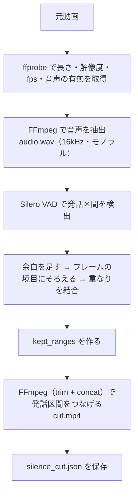

# 02. ステップ1：無音カット

元動画から「話していない部分（無音）」を取り除き、発話部分だけをつなげた `cut.mp4` を作る。以降のステップ（文字起こし・LLM・書き出し）はすべて `cut.mp4` の時間を基準にする。

担当ファイル：`backend/core/silence_cutter.py`（FFmpeg の呼び出しは `backend/core/media.py`）

---

## 1. 入力と出力

### 入力

| 項目 | 内容 |
|---|---|
| 元動画 | `.mp4` / `.mov` / `.mkv` / `.avi` / `.webm`。映像と音声の両方が必要 |
| 作業フォルダ | `temp/{project_id}/` |
| オプション | `POST /projects` の `options.silence`（下の「3. パラメータ」） |

### 出力（作業フォルダ内）

| ファイル | 内容 |
|---|---|
| `audio.wav` | 元動画から抽出した音声（16kHz・モノラル・16bit PCM）。VAD 用で、**元動画の時間が基準** |
| `cut.mp4` | 無音カット後の動画（H.264 + AAC）。プレビュー再生と書き出しの元になる |
| `silence_cut.json` | 残した区間の対応表（`kept_ranges`）と動画の情報。サーバー再起動後やステップ2以降のやり直しに使う |
| `cut_filter.txt` | FFmpeg に渡したフィルター（区間が多いときだけ作る。デバッグ用） |

`silence_cut.json` の中身は、`GET /projects/{id}/result` の `silence_cut` と同じ形に、使ったオプションと動画の情報を加えたもの。

```json
{
  "source_path": "C:/Users/me/Videos/vlog_0929.mp4",
  "options": { "enabled": true, "vad_threshold": 0.5, "min_silence_ms": 500, "padding_ms": 150 },
  "media": { "duration": 612.48, "width": 1920, "height": 1080, "fps": 29.97, "has_audio": true },
  "enabled": true,
  "original_duration": 612.48,
  "cut_duration": 498.12,
  "removed_duration": 114.36,
  "kept_ranges": [
    { "source_start": 0.3, "source_end": 15.882, "output_start": 0.0, "output_end": 15.582 }
  ]
}
```

---

## 2. 処理の手順



### 2.1 動画の確認（ffprobe）

- ファイルがない → `FILE_NOT_FOUND`
- 拡張子が対応外、映像がない、長さが取れない、音声がない → `UNSUPPORTED_FORMAT`
- fps は `avg_frame_rate`（取れなければ `r_frame_rate`）を使う

### 2.2 音声の抽出

```
ffmpeg -i <元動画> -vn -ac 1 -ar 16000 -c:a pcm_s16le audio.wav
```

### 2.3 発話区間の検出（Silero VAD）

- faster-whisper に同梱されている Silero VAD（ONNX 版）を使う。PyTorch が不要になり、インストールが軽くなる。ステップ2でも faster-whisper を使うので、依存ライブラリも増えない。
- VAD には次の値を渡す。余白（`padding_ms`）は VAD には任せず、次の 2.4 で自前で足す（区間の計算を分かりやすくするため）。

| VAD の設定 | 値 |
|---|---|
| `threshold` | `vad_threshold` |
| `min_silence_duration_ms` | `min_silence_ms`（これより短い無音は発話の一部とみなす） |
| `min_speech_duration_ms` | `250`（固定。これより短い音は咳や物音とみなして捨てる） |
| `speech_pad_ms` | `0` |

### 2.4 残す区間（`kept_ranges`）の計算

1. 各発話区間の前後に `padding_ms` の余白を足す（動画の先頭・末尾ははみ出さない）
2. 区間の境目を **フレームの境目**（`1 / fps` の倍数）にそろえる
3. 重なった区間・くっついた区間を1つにまとめる
4. 前から順に長さを足していき、カット後の時間（`output_start` / `output_end`）を決める

**フレームにそろえる理由**：映像はフレーム単位でしか切れない。そろえずに切ると、区間ごとに最大1フレームずつ誤差が出て、区間が多いほどテロップの時間がずれていく。

**例**（fps と端数は省略、`padding_ms = 150`）

| 発話区間（元動画） | 余白を足す | 結合後 | カット後の時間 |
|---|---|---|---|
| 1.00〜3.00 | 0.85〜3.15 | 0.85〜3.15 | 0.00〜2.30 |
| 3.20〜5.00 | 3.05〜5.15 | （上と結合）0.85〜5.15 | 0.00〜4.30 |
| 8.00〜9.00 | 7.85〜9.15 | 7.85〜9.15 | 4.30〜5.60 |

- JSON に書き出すときは小数点以下3桁に丸める（計算は丸めずに行う）。
- 発話が1つも見つからなかったときは、動画全体を残す（処理を止めない方針。ステップ2で文字起こし結果が空になる）。
- `silence.enabled = false` のときは VAD を使わず、動画全体を1つの区間として扱う。`cut.mp4` は同じ手順で作る（`.mkv` などをプレビューで再生できる形にそろえるため）。

### 2.5 発話区間をつなげる（FFmpeg）

区間ごとに映像を `trim`、音声を `atrim` で切り出し、`concat` でつなげる。1回のエンコードで済み、映像と音声がずれない。

```
[0:v:0]trim=start=S0-h:end=E0-h,setpts=PTS-STARTPTS[v0];
[0:a:0]atrim=start=S0:end=E0,asetpts=PTS-STARTPTS[a0];
...
[v0][a0][v1][a1]...concat=n=N:v=1:a=1[outv][outa]
```

- `h` は半フレーム（`0.5 / fps`）。フレームの時刻がちょうど境目に来たときに、小数の誤差で前後のフレームが入ったり抜けたりしないようにする。
- エンコード設定：`libx264`（`-crf 18 -preset veryfast -pix_fmt yuv420p`）、`aac 192k`、`-movflags +faststart`（プレビューですぐシークできるように）。
- Windows のコマンドラインは約32,000文字までなので、フィルターが8,000文字を超えたら `cut_filter.txt` に書いてファイルで渡す。FFmpeg 7 までは `-filter_complex_script`、それより新しい版（またはバージョンが読めない開発版）では `-/filter_complex` を使う。
- 書き込み中は `cut.partial.mp4` に出力し、成功したら `cut.mp4` に名前を変える（途中で失敗・中断しても、壊れた `cut.mp4` が残らないように）。

---

## 3. パラメータ（`options.silence`）

| キー | 既定値 | 範囲 | 説明 |
|---|---|---|---|
| `enabled` | `true` | - | `false` にすると無音カットを行わない |
| `vad_threshold` | `0.5` | 0.0〜1.0 | 発話と判定するしきい値。高いほど厳しい（小さい声や雑音をカットしやすくなる） |
| `min_silence_ms` | `500` | 0 以上 | この長さ以上の無音だけをカットする |
| `padding_ms` | `150` | 0 以上 | 発話区間の前後に残す余白（言葉の頭切れ・語尾切れを防ぐ） |

実際にカットされる長さは「無音の長さ − 余白 × 2」になる。既定値では、500ms の無音のうち 200ms がカットされる。

---

## 4. 進捗と中断

進捗は 0〜100 で呼び出し元に返す。API はこれを `steps[].progress`（`silence_cutting`）に入れる。

| 工程 | 進捗 |
|---|---|
| 音声の抽出 | 0 → 10（FFmpeg の `-progress` から計算） |
| VAD | 10 → 25（途中経過はなし） |
| つなげる（エンコード） | 25 → 100（FFmpeg の `-progress` から計算） |

中断は `threading.Event` で受け取る。工程の切り替わりと、FFmpeg の実行中（約0.5秒ごと）に確認し、FFmpeg を止めて `CancelledByUser` を送出する。

---

## 5. エラー

エンジンは `EngineError(code, message, details)` を送出する。`code` は `01_api_schema.md` の「2.1 エラーレスポンス」に合わせる。

| code | 発生条件 |
|---|---|
| `FILE_NOT_FOUND` | 元動画が存在しない |
| `UNSUPPORTED_FORMAT` | 対応外の拡張子、映像・音声がない、ffprobe で読めない |
| `FFMPEG_ERROR` | FFmpeg / ffprobe が見つからない、または実行に失敗した（`details.stderr` に FFmpeg の出力の末尾を入れる） |
| `INTERNAL_ERROR` | faster-whisper（VAD）がインストールされていない |

---

## 6. 単体での動かし方

API を作る前でも、コマンドラインから試せる。

```
cd backend
python -m core.silence_cutter C:/Users/me/Videos/test.mp4 ../temp/test --padding-ms 150
```

FFmpeg の場所は、環境変数 `EDITAI_FFMPEG` / `EDITAI_FFPROBE` で変えられる（既定は PATH 上の `ffmpeg` / `ffprobe`）。

---

## 7. 今後の検討事項

- ステップ2（文字起こし）は、`audio.wav`（元動画の時間）ではなく **`cut.mp4` の音声** を使う。時刻をカット後の動画に合わせるため。詳しくは `03_transcription.md` で決める。
- 可変フレームレート（スマホの動画など）では、フレームへのそろえ方が近似になる。ずれが目立つようなら、`cut.mp4` を固定フレームレートで書き出すことを検討する。
- NVIDIA GPU があるときに `h264_nvenc` でエンコードを速くするかは、動作確認のあとに決める。
